<p align="center"></p>

# 🔎 Regex Playground

A small, privacy-first regular-expression workbench that runs entirely in your browser. Write a pattern, paste sample text, and inspect matches and capture groups as you edit.

## 💡 Why this exists

Regular expressions are powerful, but debugging them in a tiny input field is frustrating. Regex Playground gives you a focused space to experiment with patterns, flags, and sample text without sending that text to a server.

## ✨ Features

- Live matching as the pattern or sample text changes.
- Match count, matched text, index, and capture-group inspection.
- Support for JavaScript regular-expression flags: `g`, `i`, `m`, `s`, `u`, and `y`.
- Clear syntax-error feedback for invalid expressions.
- Example patterns for common learning tasks.
- Local-only processing: the page does not upload your text.
- Responsive, dependency-free single-page interface.

## 📌 Project structure

```text
regex-playground/
|-- index.html   # UI, matching logic, and styling
|-- README.md    # Project guide
```

The first version intentionally uses the browser's native JavaScript `RegExp` engine. It is a learning and testing aid, not a complete cross-language regex compatibility checker.

## 🚀 Run it

No package manager or build step is required.

1. Clone this repository.
2. Open `index.html` in a modern browser.
3. Enter a pattern and sample text. Results update automatically.

You can also serve the folder locally:

```bash
python -m http.server 8000
```

Then visit `http://localhost:8000`.

## 🧪 Example

Try this pattern:

```regex
([A-Z][a-z]+)\s+(\d+)
```

With this sample:

```text
Ada 1843
Grace 1906
alan 1912
```

The first two lines match. The captures show the name and number separately. The lowercase name does not match because the first group expects an uppercase initial.

## 🗺️ Roadmap

- [ ] Add a searchable pattern cookbook.
- [ ] Add replace-preview mode with safe, explicit controls.
- [ ] Add permalink-free local export/import of test cases.
- [ ] Add a visual explanation panel for common regex tokens.
- [ ] Add optional compatibility notes for other regex engines.

## 🤝 Contributing

Issues and pull requests are welcome. Keep changes small, explain browser compatibility assumptions, and add a reproducible example for bug reports. Please do not include private or sensitive text in public issue examples.

## 📄 License

MIT. See [LICENSE](LICENSE) when the license file is added. Until then, treat this repository as an early project and check with the maintainer before redistributing substantial portions.
